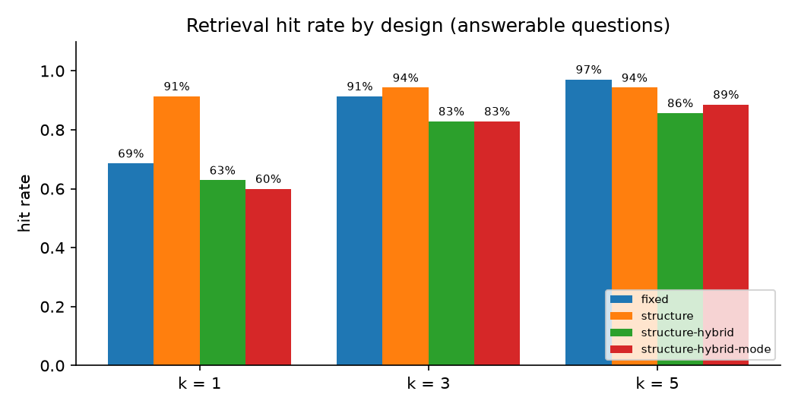

# Assignment 3 Report

- **Name**:
- **Student ID**:
- **Group**: [BBADBA 5A | BBADBA 5B | PPLEDBA 5A]

> Numbers marked **[run]** come from `eval/summary.md` after `uv run python main.py evaluate`. Replace them with your own results before submitting.

## Use case

**Who asks.** Customer-service agents at a travel agency (or a consumer helpline) who handle complaints about delayed, cancelled or overbooked journeys by plane, train, coach or ferry in the EU. They ask in English while a customer is waiting.

**What they do with the answer.** They tell the customer whether they are owed compensation, a refund, re-routing or care (meals, hotel), how much, and by when; then they file the claim or close the case.

**Cost of a wrong answer vs "I don't know".** A wrong "yes" makes the agency promise money the carrier will not pay (angry customer, lost trust, sometimes the agency pays it itself). A wrong "no" denies a customer money the law gives them (EUR 250-600 per flight passenger, 25-50 % of a rail or ferry ticket) and exposes the agency to complaints to the national enforcement body. "I don't know" costs a few minutes: the agent opens the regulation or escalates. So the system must prefer refusing to guessing. The typical dangerous error is a *correct rule from the wrong regulation* (e.g. the rail 60-minute threshold applied to a coach, where it is 120 minutes), which is why the corpus deliberately mixes four transport modes with similar but different rules.

## Corpus

| Document (source id) | URL | Date | Licence | Words (after cleaning) |
|---|---|---|---|---|
| Regulation (EC) No 261/2004, air passenger rights (`air-261-2004`) | https://eur-lex.europa.eu/legal-content/EN/TXT/?uri=CELEX:32004R0261 | 11.2.2004 | EU legal acts, free reuse with attribution (Commission Decision 2011/833/EU; © European Union) | 4,055 |
| Commission Interpretative Guidelines on Reg. 261/2004, C/2024/5687 (`air-guidelines-2024`) | https://eur-lex.europa.eu/legal-content/EN/TXT/?uri=CELEX:52024XC05687 | 25.9.2024 | same | 18,195 |
| Regulation (EU) 2021/782, rail passengers' rights (`rail-2021-782`) | https://eur-lex.europa.eu/legal-content/EN/TXT/?uri=CELEX:32021R0782 | 29.4.2021 | same | 22,342 |
| Regulation (EU) No 181/2011, bus and coach passengers (`bus-181-2011`) | https://eur-lex.europa.eu/legal-content/EN/TXT/?uri=CELEX:32011R0181 | 16.2.2011 | same | 6,822 |
| Regulation (EU) No 1177/2010, sea and inland waterway passengers (`sea-1177-2010`) | https://eur-lex.europa.eu/legal-content/EN/TXT/?uri=CELEX:32010R1177 | 24.11.2010 | same | 8,102 |
| **Total** | | | | **59,516** |

All five are public EU law with no personal data. `index.py` downloads them itself from the EU Publications Office (CELLAR) by CELEX number, so `corpus/` is not committed. Added later through `add_document` (see below): Regulation (EC) No 1107/2006 on disabled passengers in air transport (`air-prm-1107-2006`, 5,515 words, committed in `extra/`).

## Ingestion

**Extract.** EUR-Lex's website answers scripts with an empty bot-challenge page (HTTP 202, 0 bytes), so `download()` asks CELLAR directly with content negotiation: XHTML for recent acts, HTML for 261/2004 (only available in the old format). `extract_lines()` reads the HTML in order, one line per paragraph and **one line per table row**, because the Official Journal lays out recitals and guideline headings as two-cell tables ("(14)" | text).

**Clean.** Remove footnote markers and footnote bodies (elements with class `oj-note-tag`/`oj-note`, `[1]` markers in the old format), non-breaking spaces and soft hyphens, normalise quotes and whitespace; drop the preamble, the signature block ("Done at Brussels…") and the footnote list that follows it, while keeping the annexes after it.

**Chunk.** `split_units()` turns the lines into legal units: `Recital N`, `Article N`, `Annex I`, and `Section 4.4.2` for the guidelines. Two chunk designs are built from the same units:

- `fixed`: 250-word windows with 50 words of overlap, blind to structure (299 chunks).
- `structure`: one chunk per unit; units longer than 300 words are split at paragraph boundaries into "part 1/2", "part 2/2"; each chunk starts with "Article 7 - Right to compensation" and is embedded with its document title in front (466 chunks).

**Extraction problems fixed.**
1. *Table of contents in the guidelines.* Every heading appears twice: once in the table of contents with a page number ("2.1. Territorial scope 5") and once in the body. A naive section parser created ~90 empty or duplicated sections. The parser now skips everything from "TABLE OF CONTENTS" until the first heading reappears without a page number.
2. *Annex articles colliding with real articles.* Annex I of the rail regulation reproduces the CIV international rules, which have their own Articles 1-64. Without a fix, "Article 32" of the CIV rules overwrote the regulation's Article 32 in the metadata. Articles after an "ANNEX" heading are now labelled `Annex I, Article 32`.
3. *Chapter headings glued to articles.* "CHAPTER V / GENERAL RULES ON INFORMATION AND COMPLAINTS" ended up at the end of the preceding article, and "HAVE ADOPTED THIS REGULATION: CHAPTER I" at the end of the last recital. These lines are now dropped.

**Metadata per chunk.** `source` (document id), `location` (unit, used for citations), `units` (all units a fixed window touches, used to score hits), `mode` (air/rail/bus/sea), `title`, `hash` of the embedded text, `added` (true for documents added later).

**Embeddings.** `gemini-embedding-2`, `RETRIEVAL_DOCUMENT` task type, truncated to 768 dimensions and L2-normalised (4× smaller index than 3,072; under 90 MB with room to spare). Each batch of 50 vectors is appended to `index/vectors.jsonl` as soon as it arrives, keyed by a hash of model + text, so a re-run embeds only chunks without a vector and the daily free-tier limit loses nothing. Both designs together cost 765 embeddings, under the ~1,000/day limit. Query embeddings are cached in `index/queries.jsonl`, so re-running the evaluation costs no quota.

## Test set

I wrote 42 questions from the documents before tuning anything, phrased the way an agent would ask while a customer is on the phone, covering all four transport modes and both the regulations and the guidelines.

| kind | count |
|---|---|
| single | 28 |
| multi (two passages) | 7 |
| unanswerable | 7 |

The multi questions mostly compare two modes (train vs ferry compensation, rail vs coach notice periods for assistance) or need two articles of the same regulation (5-hour flight delay → Article 6 gives the right, Article 8 the 7-day refund). The unanswerable questions stay close to the corpus: airline fees, national limitation periods, the 2025 reform negotiations, Renfe's own policy.

Two examples:
- **q26 (single)**: "A ferry crossing scheduled for 6 hours arrives 2.5 hours late. What compensation is due?" → `sea-1177-2010`, `Article 19` → 25 % of the ticket price (journeys of 4-8 hours: at least 2 hours' delay; 50 % only beyond 4 hours).
- **q36 (unanswerable)**: "How far in advance must a wheelchair user notify the airline to get assistance at the airport?" The corpus has the rule for trains (24 h), coaches (36 h) and ferries (48 h) but not for planes, so this is a trap: the right answer is "not covered", not another mode's number.

## Retrieval

Hit = the expected source **and** location appear among the top k results (for multi questions, at least one of them; the last column requires both). 35 answerable questions. **[run]**

| design | hit@1 | hit@3 | hit@5 | multi: both in top 5 | words added at k=5 |
|---|---|---|---|---|---|
| fixed (250-word windows, dense) | | | | | |
| structure (legal units, dense) | | | | | |
| structure-hybrid (dense + BM25, RRF) | | | | | |
| structure-hybrid-mode (+ transport-mode filter) | | | | | |



Designs 3 and 4 reuse the `structure` vectors, so they cost no extra embeddings. BM25 helps with exact legal terms and numbers ("Article 19", "120 minutes"); the mode filter keeps a train question from retrieving the ferry rule.

**Choice.** **[run]** *Write which design wins on hit@3 (the agent reads 5 results but the first 3 matter most), the trade-off in words added to the prompt, and set `"search_design"` in `index/config.json` to it.*

## Tools and subagent

**search(query)** (docstring = description the model reads):
> Search EU passenger rights law: Regulation 261/2004 on air passenger rights (denied boarding, cancellation, long delay) with the Commission's 2024 interpretative guidelines, Regulation 2021/782 on rail passengers, Regulation 181/2011 on bus and coach passengers and Regulation 1177/2010 on sea and inland waterway passengers, plus any document added later. Use it for every question about compensation, refunds, re-routing, care (meals, hotels), delays, cancellations, disabled passengers or complaints in EU transport. Write the query in English legal terms and name the transport mode […]. Returns the 5 most relevant passages, each headed by "cite as [source, location]" […].

**add_document(path)**:
> Add a document to the passenger-rights index so search can find it. `path` is a local file (EU legal act as HTML/XHTML from EUR-Lex, PDF, TXT or Markdown). The file goes through the same pipeline as the corpus […]. If the identical file is already indexed nothing changes; if another version of a file with the same name is indexed, its chunks are replaced. […] Only call it when the user asks to add a document; it needs their approval.

**One search result** (first of five for q01):

```
--- Result 1 | cite as [air-261-2004, Article 7]
Document: Regulation (EC) No 261/2004 - air passenger rights (denied boarding, cancellation, delay)
Mode: air

Article 7 - Right to compensation
1. Where reference is made to this Article, passengers shall receive compensation amounting to:
(a) EUR 250 for all flights of 1500 kilometres or less;
(b) EUR 400 for all intra-Community flights of more than 1500 kilometres, and for all other flights between 1500 and 3500 kilometres;
(c) EUR 600 for all flights not falling under (a) or (b). […]
```

**Subagent** (`.claude/agents/corpus-researcher.md`, tools: `mcp__corpus__search` only): searches before answering, at most four searches, answers only from the passages, keeps transport modes apart, cites every claim as `[source, location]`, starts with "The documents I have do not cover this." when the corpus does not answer, and replies in at most ~150 words with a Sources line.

**Transcript from Claude Code in VS Code** **[run]**:

```
(paste here: the prompt you typed, the subagent's search calls and its final answer)
```

## Adding a document

**Already indexed?** `add_file()` hashes the file (SHA-256). Same name and same hash → nothing is embedded and the tool says "already indexed with identical content; nothing changed". Same name, different hash → it is treated as a new version: the new chunks are embedded first and only then replace the old ones, so if the quota runs out half-way the old version stays searchable. A new name → added. Added documents are stored with `added: true`, only in the chunk design the server searches (no quota wasted on the other one).

**Before and after** (`eval/before_after.md`) **[run]**: q36, "How far in advance must a wheelchair user notify the airline to get assistance at the airport?". Document added: `extra/air-prm-1107-2006.html` (Regulation (EC) No 1107/2006), whose Article 7 sets a 48-hour notice.

- Before: *(paste)*
- After: *(paste)*

## Harness and guardrails

**AGENTS.md** (system prompt of `agent.py`, also read by the editor's agent): 9 rules, each with its reason: search before every answer; answer only from the results; cite every claim as `[source, location]` and never cite what was not retrieved; keep transport modes apart; start with "The documents I have do not cover this." when not covered (partial answers say which part is missing); search again with other words, at most four times; be short (≤150 words, direct answer first); never add documents unasked; no predictions about how a court or airline will decide.

**Approval step.** `HumanInTheLoopMiddleware(interrupt_on={"add_document": …})` with a LangGraph checkpointer: when the model calls `add_document`, the run pauses, the harness prints the tool call and asks `Approve? [y/N]`, and resumes with `approve` or `reject`. Without a terminal (evaluation, CI) the answer is always reject. Call limits: 8 model calls and 4 searches per run (`ModelCallLimitMiddleware`, `ToolCallLimitMiddleware`).

**Extra guardrail: citation check.** After the agent answers, code parses every `[source, location]` in the answer and checks that (a) a non-refusal answer has at least one citation and (b) every citation matches a passage the search tool returned in this run (a paragraph like "Article 7(1)" matches a retrieved "Article 7"). If the check fails, the agent gets one correction message listing the bad citations; if it fails again, the answer is replaced by a refusal. Why this one: in this use case the agent shows the citation to the customer, so an invented article number is worse than no answer. **[run]** *Case where it fired: question id, the first answer, the problem, the corrected answer (`eval/answers.jsonl`, field `guardrail`).*

## Evaluation

**Code checks** (`evaluate.py`, `code_checks`): refusal (the fixed phrase), citation present, every citation valid (returned by the tool), expected passage retrieved, expected passage cited, number of searches. Code decides what code can: an answerable question that was refused is wrong; an unanswerable one that was refused is right; an unanswerable one that was answered is wrong.

**Judge.** Gemini with temperature 0 and a JSON schema, given the question, its kind, the reference answer, **the retrieved passages** and the answer. Rubric (full text in `evaluate.py`): `correct` = key facts of the reference (amounts, thresholds, deadlines, yes/no) for the right transport mode, nothing contradicting it, no missing condition that changes the outcome, both parts for multi questions, and for unanswerable questions a clear "not covered" without presenting an answer; `supported` = every factual claim is in the passages (true-but-not-retrieved counts as unsupported). Instruction: be strict, a confident wrong number is worse than "I don't know".

**Agreement with my grades** **[run]**: I graded N answers in `eval/human_labels.csv` from `eval/to_grade.csv`, which has no judge columns, before opening `eval/results.csv`.

| grade | n | agreement | Cohen's kappa |
|---|---|---|---|
| correct | | | |
| supported | | | |

*Comment on where you and the judge disagreed and who was right.*

**Results** **[run]**:

| | count |
|---|---|
| correct (answerable) | / 35 |
| unsupported answers | |
| correct refusals | / 7 |
| wrong refusals | / 35 |

## Failures

**[run]** From `eval/failures.csv` (cause suggested by code, confirmed or changed by me in `cause_final`):

| cause | count | examples |
|---|---|---|
| retrieval miss | | |
| wrong answer from right passage | | |
| unsupported claim | | |
| wrong refusal | | |
| bad test question | | |

**What to fix first.** *Pick the biggest cause and say what you would change (e.g. retrieval misses → query rewriting with the article number or more results for multi questions; wrong answers from the right passage → a rule in AGENTS.md about thresholds; unsupported claims → stricter citation check per sentence).*

## Decision

*Would you let agents rely on it? For what (e.g. thresholds and amounts in the four regulations, with the article to show the customer) and not for what (extraordinary circumstances, national law, anything the corpus does not cover)? With which safeguard (citations always shown and clickable; refusals escalated; a human checks any claim above a given amount)?*

**Cost and latency** **[run]**: about ___ input and ___ output tokens, ___ model calls and ___ searches per question; ___ s per question. On the free tier this costs $0; at list price (gemini-2.5-flash, $0.30/M input, $2.50/M output) about $___ per question.

## AI use

I used **Claude** (Anthropic), provided by IE University, which our professor confirmed is the AI tool allowed for this assignment. Claude helped me with:

- **Code**: it wrote most of `index.py`, `retrieval.py`, `server.py`, `agent.py`, `evaluate.py` and `settings.py`, and tested them offline with fake embeddings and a scripted fake model before I ran them with my Gemini key.
- **Options and drafting**: it proposed several use cases (I chose EU passenger rights), drafted the test questions and reference answers from the regulations, the AGENTS.md rules, the judge rubric and a first version of this report, which I checked against the documents and edited.
- **Studying**: it wrote study notes explaining each part, which I used to prepare for the written comprehension check.

I ran every command myself, graded the answers in `eval/human_labels.csv` myself without looking at the judge's verdicts, and wrote or rewrote the analysis, failure classification and decision with my own results.
